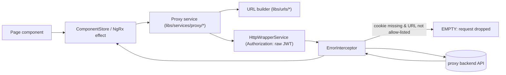
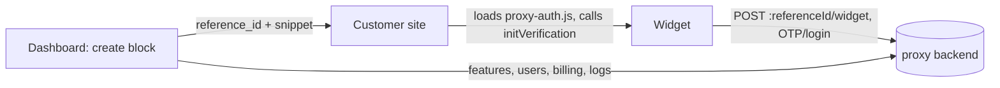

# Architecture

proxy-ui is an Nx monorepo (Angular 21, standalone components, NgRx, Tailwind v4, Angular Material) holding the frontend of the "36 Blocks" product. It has two apps. `apps/36-blocks` is the customer dashboard plus the public marketing site. `apps/36-blocks-widget` is an embeddable auth widget, shipped as one script (proxy-auth.js) that customers paste into their own sites. Both are pure client-side SPAs. They talk to a backend "proxy" API that lives in another repo; this repo has no server, database or queue of its own.

## Entry point and startup

### Dashboard (`apps/36-blocks`)
1. `apps/36-blocks/src/main.ts` calls `bootstrapApplication(AppComponent, appConfig)`.
2. `apps/36-blocks/src/app/app.config.ts:appConfig` sets up:
   - the router (`appRoutes`)
   - `provideHttpClient(withFetch(), withInterceptorsFromDi())`, with `ErrorInterceptor` registered through `HTTP_INTERCEPTORS`
   - the root NgRx store with `clearStateMetaReducer`, plus the `auth` and `registration` slices, and `RootEffects`, `LogInEffects`, `RegistrationEffects`
   - Firebase compat (`AngularFireModule.initializeApp`)
   - the `ProxyBaseUrls` DI tokens (`BaseURL` and `ProxyLogsUrl` both = `environment.baseUrl`; `IToken` = a mutable `{token, companyId}` object)
   - Material defaults
3. `APP_INITIALIZER` → `apps/36-blocks/src/app/core/auth-initializer.service.ts:AuthInitializerService` copies the `authToken` cookie into the in-memory token before the first navigation.
4. `apps/36-blocks/src/app/app.routes.ts:appRoutes` lazy-loads the website (`''`), the panel (`app`), `onboarding`, `project`, `widget-preview/:referenceId` and `client/registration`. The full table is in [ui/routes.md](ui/routes.md).

The SSR files (`apps/36-blocks/src/main.server.ts`, `apps/36-blocks/src/server.ts`, `app.config.server.ts`, `app.routes.server.ts`, `app.config.browser.ts`) are dead leftovers: SSR was removed in commit 64b28e3c and nothing builds them. See [modules/app-shell.md](modules/app-shell.md).

### Widget (`apps/36-blocks-widget`)
1. The built proxy-auth.js is an IIFE wrapper from `apps/36-blocks-widget/build-elements.js`. It returns at once if `window.__proxyAuthLoaded` is set; otherwise it injects the inlined CSS and runs the concatenated bundle.
2. `apps/36-blocks-widget/src/main.ts` imports zone.js and the side-effect module `apps/36-blocks-widget/src/app/init-verification.ts`. That module defines `window.initVerification`, `window.__proxyAuth`, and a buffer for early `openAddUserDialog` events.
3. `createApplication()` provides the store (`otp` slice + `OtpEffects`), hCaptcha, and the `ProxyBaseUrls` tokens (`environment.apiUrl + environment.msgMidProxy`). It then registers `ProxyAuthWidgetComponent` as the custom element `proxy-auth`.
4. `injector.get(UserManagementBridgeService)` runs eagerly, so events buffered before bootstrap are drained.
5. Nothing renders until the host page calls `window.initVerification(config)`. That call mounts `<proxy-auth>` into the container div; see [flows/widget-verification.md](flows/widget-verification.md).

## Layers

| Layer | Folder | Owns | May call | Must not |
|---|---|---|---|---|
| Dashboard pages | `apps/36-blocks/src/app/panel/`, `apps/36-blocks/src/app/website/`, `apps/36-blocks/src/app/core/` | Routed standalone components, per-page `<page>.store.ts` ComponentStores, the global NgRx store | `libs/services/**`, `libs/ui/**`, `libs/constant`, `libs/models/**` | Call `HttpClient` directly for proxy API calls (use a service in `libs/services/proxy/`) |
| Widget | `apps/36-blocks-widget/src/app/otp/` | Widget screens, the `otp` NgRx slice, `OtpService` and its own URL constants | `libs/services/http-wrapper-no-auth`, `libs/constant`, `libs/models/**`, `libs/utils` | Import `@proxy/services/proxy/*`, `@proxy/services/httpWrapper` or login services (they need `AngularFireAuth` and `IToken`, which the widget doesn't provide); use dynamic `import()` |
| Proxy API services | `libs/services/proxy/`, `libs/services/login` | One injectable per backend domain, returning the wrapper Observable unchanged | `libs/urls/**`, `libs/services/http-wrapper` | Hold state |
| HTTP | `libs/services/http-wrapper`, `libs/services/http-wrapper-no-auth`, `libs/services/interceptor/error-interceptor` | Headers, the token, error mapping, 401 handling | `HttpClient` | Be used across apps the wrong way round (auth wrapper in the widget) |
| Contracts and helpers | `libs/urls/**`, `libs/models/**`, `libs/constant`, `libs/utils`, `libs/regex`, `libs/custom-validator` | URL builders, response envelope types, the `WidgetConfig` / `PublicScriptType` contract | nothing app-level | Import from `apps/**` (`AnalyticsService` breaks this today) |
| Shared UI | `libs/ui/**`, `libs/directives/**`, `libs/pipes/**`, `apps/shared/scss/` | Reusable components and global styles | Angular Material, `libs/constant` | |

Dependencies point downward. Apps import libs only through the `@proxy/...` aliases in `tsconfig.base.json` (table in [modules/shared-libs.md](modules/shared-libs.md)). Two known exceptions to the direction:
- `apps/36-blocks/src/app/panel/features/create-feature/create-feature.component.ts` imports `WidgetThemeService` straight from the widget app.
- The analytics service in `libs/services` imports types from the dashboard app.

## How a request moves

1. A page dispatches to its ComponentStore (`apps/36-blocks/src/app/panel/`) or a global effect (`apps/36-blocks/src/app/core/ngrx/effects/root/root.effect.ts:RootEffects`).
2. The store calls a service from `libs/services/proxy/`. The service builds the URL with a `libs/urls/` builder over `ProxyBaseUrls.BaseURL`.
3. `libs/services/http-wrapper` adds the in-memory JWT as the raw `Authorization` header (no `Bearer`).
4. `libs/services/interceptor/error-interceptor` returns `EMPTY` when there is no `authToken` cookie and the URL isn't allow-listed. It retries once on status 0, maps 4xx/5xx to the envelope `{errors, hasError: true}`, and on 401 logs the user out.
5. The store checks `res.hasError`, because a 200 can carry an error, and patches its state.

The widget follows the same shape, with `OtpService` → `libs/services/http-wrapper-no-auth`, and `reference_id` or `proxy_auth_token` headers in place of `Authorization`. Endpoint lists are in [api.md](api.md). Detailed flows:
- [flows/dashboard-login.md](flows/dashboard-login.md)
- [flows/feature-configuration.md](flows/feature-configuration.md)
- [flows/widget-verification.md](flows/widget-verification.md)

## How the two apps connect

The dashboard is where a customer configures a "block" (a feature) and gets its `reference_id`. Its preview page and code snippet load the widget script from `${environment.proxyServer}/assets/proxy-auth/proxy-auth.js`, the same origin that serves the dashboard. The full build writes the widget bundle into the dashboard's dist folder (see [Build](#build)), so one deploy ships both apps.

## Build

- Both apps use the `@angular-devkit/build-angular:application` (esbuild) executor. `tsconfig.base.json` sets `target: ES2022` and `useDefineForClassFields: false`.
- `npm run build[:test|:stage|:prod]` runs three steps in order:
  1. the widget build (`tools/set-env.js --auth`, then `nx build 36-blocks-widget`)
  2. the dashboard build (`tools/set-env.js --proxy`, then `nx build 36-blocks`, then `tools/postbuild.js`, which writes version.json)
  3. `postbuild:proxy-auth:elements`, which runs `apps/36-blocks-widget/build-elements.js`

  Step 3 must run after the dashboard build, because it writes the generated proxy-auth.js into the dashboard's dist assets/proxy-auth/ folder.
- `tools/set-env.js` writes the git-ignored env-variables.ts for each app from .env / `process.env`. Every value ends up in a public browser bundle. See [environment.md](environment.md).
- Deploys appear to run on AWS Amplify, inferred from `AWS_BRANCH` detection in `tools/set-env.js`.
  > [!TODO] Needs a human: confirm the deploy target and which branch deploys to which environment.

## External systems

| System | Used for | Client code | Doc |
|---|---|---|---|
| Proxy backend API (other repo; base URL per environment) | Every data call from both apps | `libs/services/proxy/`, `apps/36-blocks-widget/src/app/otp/service/otp.service.ts:OtpService`, `apps/36-blocks/src/app/panel/billing/billing.service.ts` | [api.md](api.md) |
| Firebase Auth (compat AngularFire) | Google login on the dashboard; sign-out on 401 | `libs/services/proxy/auth`, `libs/services/interceptor/error-interceptor` | [modules/app-shell.md](modules/app-shell.md) |
| MSG91 OTP provider script (otp-provider.js, `window.initSendOTP`) | "Login with OTP" inside the widget | `apps/36-blocks-widget/src/app/otp/service/otp-widget.service.ts:OtpWidgetService` | [modules/widget-auth.md](modules/widget-auth.md) |
| hCaptcha (`ng-hcaptcha`) | Captcha on widget password login | `apps/36-blocks-widget/src/main.ts` | [modules/widget-auth.md](modules/widget-auth.md) |
| Lago billing, behind backend `v1/billing/*` | Plans, subscriptions, checkout redirect | `apps/36-blocks/src/app/panel/billing/billing.store.ts` | [modules/panel-ops.md](modules/panel-ops.md) |
| viaSocket / GTWY chatbot script, `flow.sokt.io` webhook | "Ask AI" chatbot in the panel; the contact form | `apps/36-blocks/src/app/panel/layout/layout.component.ts`, `apps/36-blocks/src/app/website/contact/contact.component.ts` | [modules/panel-ops.md](modules/panel-ops.md) |
| Apache ECharts | Dashboard analytics charts | `apps/36-blocks/src/app/panel/dashboard/` | [modules/panel-ops.md](modules/panel-ops.md) |

## Cross-repo contracts

> [!WARNING]
> The widget's public API is used by customer sites we don't control. Never rename or remove any of these: `window.initVerification`, the `proxy-auth` tag, `window.__proxyAuth`, the `openAddUserDialog` event, the `userProxyContainer` container id, the assets/proxy-auth/proxy-auth.js path, or any value of `PublicScriptType`, `WidgetAuthType` or `WidgetTheme` in `libs/constant/src/verification/verification.ts`. Add values; never rename. The contract is in [api.md](api.md).

> [!WARNING]
> The backend response envelope `{data, status, hasError, errors}` (`libs/models/root-models/src/index.ts:BaseResponse`) and the two id spaces of a block are backend contracts:
> - numeric `id` for feature CRUD
> - string `reference_id` for the widget and billing
>
> Mixing the two up fails silently. See [glossary.md](glossary.md).

## Decisions and history

The full list, with evidence for each, is in [decisions.md](decisions.md). The ones that shape this page:

- **One file for the widget.** Customers paste one `<script>` tag, so `build-elements.js` concatenates polyfills → vendor → scripts → main, skips `chunk-*` files and inlines the CSS. A dynamic `import()` creates an ESM chunk that breaks this, which is why the widget has none (lesson from the March 2026 build fixes).
- **Shadow DOM for the widget.** `ProxyAuthWidgetComponent` uses `ViewEncapsulation.ShadowDom`, and overlays get their own shadow hosts on `document.body`, so host-page CSS can't break the widget. See [modules/widget-embed.md](modules/widget-embed.md).
- **Angular upgrades went one major version at a time**, on separate branches (`angular-v18-migration`, `angular-v21-migration`), because any change to the bundle or CSS can silently break customer sites. `@angular/fire` must move in lockstep with Angular. The Firebase compat API is still in use, so moving to the modular API is still pending.
- **The Nx Cloud runner was removed** after the org plan was disabled, so builds use the local runner. Don't add `nx-cloud` back.
- **SSR was removed** in commit 64b28e3c (PR #621).
  > [!TODO] Needs a human: why was SSR dropped, and can the leftover server files be deleted?
