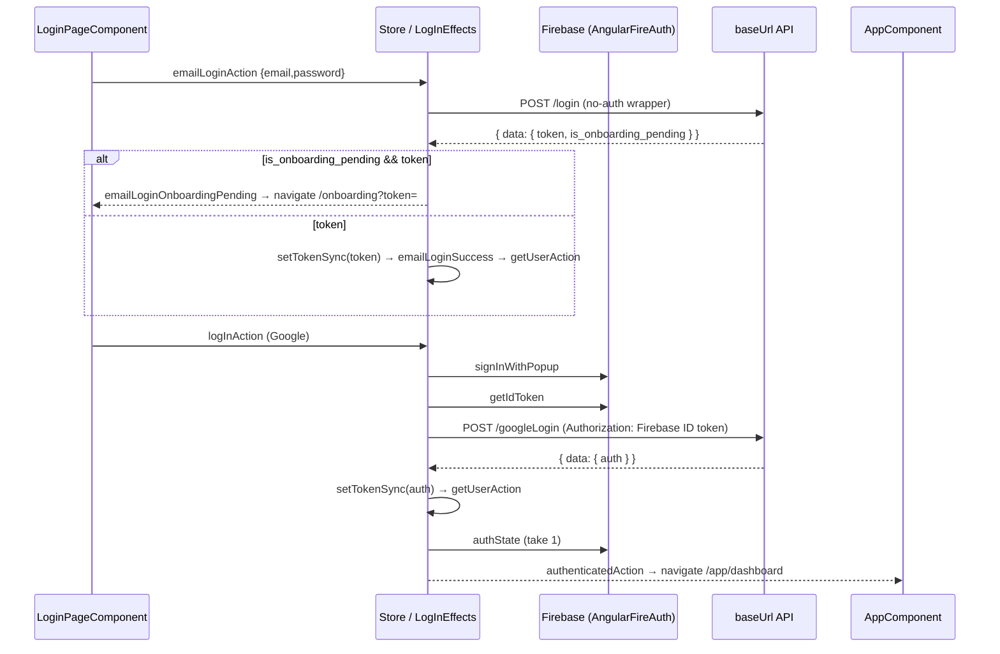

# Flow: dashboard login, session and logout

A visitor signs in on `/login` (email/password or Google via Firebase popup) or signs up on `/register`; the result is a proxy JWT stored in the `authToken` cookie and in `AuthService` memory, and a redirect to `/onboarding` or `/app/dashboard`. This doc also follows the session afterwards: boot with an existing cookie, the route guard, 401 handling, client switching and logout. Module context (store shape, guards table, token table) is in [app-shell](../modules/app-shell.md) and [shared-libs](../modules/shared-libs.md); endpoint list in [api.md](../api.md).



## Steps

### A. Email/password login

1. **Submit form** — `apps/36-blocks/src/app/website/login/login-page.component.ts:LoginPageComponent.submitLogin`
   Invalid form → `markAllAsTouched` and stop. Otherwise dispatches `emailLoginAction({ email, password })` and sets `loginInProgress`.
2. **Call backend** — `apps/36-blocks/src/app/website/home/ngrx/effects/login.effects.ts:LogInEffects.emailLogin$` → `libs/services/proxy/users/src/lib/services-proxy-users.module.ts:UsersService.emailLogin`
   `POST {baseUrl}/login` (`UsersUrl.emailLogin`) through the no-auth `HttpWrapperService` (`libs/services/http-wrapper-no-auth/`), so no `Authorization` header. The request still passes `ErrorInterceptor`; it is allowed without a cookie because the URL contains `api/login`.
3. **Branch on response** — same effect.
   - `response.hasError` → `throwError(message)` → `logInActionError({ errors })` → page shows `loginErrors`.
   - `is_onboarding_pending === true` (at `data` or top level) **and** a token → `emailLoginOnboardingPending({ pendingJwtToken })`. Nothing is stored. → step A4.
   - token present → `AuthService.setTokenSync(token)` (cookie + memory) → `emailLoginSuccess()` → step A5.
   - no token and no error → `emailLoginSuccess()` with nothing stored.
4. **Onboarding redirect** — `LoginPageComponent.ngOnInit` (subscription on `emailLoginOnboardingPending`)
   `router.navigate(['/onboarding'], { queryParams: { token } })`. `OnboardingComponent.ngOnInit` reads `onboarding_token`, so it gets `null` (see Errors). `OnboardingComponent.submitOnboarding` → `UsersService.submitOnboarding` → `POST {baseUrl}/onboarding` with `{ user, client, onboarding_token }`; on success it stores `data.token` with `setTokenSync` and navigates to `/app/features/create` (continues in [feature-configuration](./feature-configuration.md)). Details: [panel-ops](../modules/panel-ops.md#onboarding-onboarding).
5. **After success** — `LoginPageComponent.ngOnInit` (subscription on `emailLoginSuccess`) dispatches `getUserAction()` → `LogInEffects.getUserAction$` reads `afAuth.authState` once.
   - Firebase user present → `authenticatedAction({ response })` → `AppComponent.ngOnInit` navigates to `/app/dashboard` because the URL is `/login`.
   - No Firebase user (the normal case for a pure email login) → `NotAuthenticatedAction`. Nothing navigates. See the warning below.

> [!WARNING]
> An email/password login that succeeds without a Firebase session ends in `NotAuthenticatedAction`, and no code navigates away from `/login`. The cookie is set, so the next navigation or reload works (`LoggedInGuard` and the `**` guard send the user to `/app/dashboard`), but the login page itself stays put. Redirects to the dashboard are wired only to `authenticatedAction` in `AppComponent`. If you fix this, navigate on `emailLoginSuccess` in `LoginPageComponent` rather than faking a Firebase user (a commented-out attempt to dispatch `authenticatedAction` from client settings is still in `LayoutComponent.ngOnInit`).

> [!TODO] Needs a human: is the missing redirect after email login known? Does the backend `/login` ever return 401 for bad credentials? If it does, `ErrorInterceptor` treats it as an expired session (toast, `signOut`, navigate to `/`) instead of letting the page show the error.

### B. Google login (Firebase popup)

1. **Trigger** — `LoginPageComponent.loginWithGoogle`, also `WebsiteLayoutComponent` (header "Login") and `HomeComponent` dispatch `logInAction()`.
2. **Popup** — `LogInEffects.googleLogin$` → `libs/services/proxy/auth/src/lib/services-proxy-auth.module.ts:AuthService.loginViaGoogle` (`signInWithPopup(new GoogleAuthProvider())`). Success → `logInActionComplete`; popup closed/failed → `logInActionError`.
3. **Exchange for proxy JWT** — `LogInEffects.authenticatedAction$`: `AuthService.getToken()` (Firebase ID token) → `libs/services/login/src/lib/services-login.module.ts:LoginService.googleLogin` → `POST {baseUrl}/googleLogin` with the raw ID token as `Authorization`, empty body. Response `BaseResponse<ILoginResponse>`; `res.data.auth` is the proxy JWT → `setTokenSync`. Then dispatches `getUserAction()`.
4. **Redirect** — `getUserAction$` finds the Firebase user → `authenticatedAction({ response: IFirebaseUserModel })` → reducer stores `logInData` → `AppComponent` navigates to `/app/dashboard` when the current URL is `/` or a website route, never from `/onboarding`.

Google login never goes to `/onboarding`: the `/googleLogin` response has no onboarding flag handling.

One Tap (`googleOneTapCredential` → `LogInEffects.googleOneTap$` → `signInWithCredential` → `logInActionComplete` → B3) is wired but off while `googleClientId` is empty; see [app-shell](../modules/app-shell.md#login-flows-store-auth).

### C. Registration

`apps/36-blocks/src/app/website/register/register-page.component.ts:RegisterPageComponent` dispatches `registrationSubmitAction({ payload: { email, password } })` → `apps/36-blocks/src/app/website/home/ngrx/effects/registration.effects.ts:RegistrationEffects.registrationSubmit$` → `UsersService.register` → `POST {baseUrl}/register` (no-auth). Success → `registrationSubmitComplete({ registeredEmail })` and the page shows "check your email". No token is stored; the user logs in later through A.

### D. App boot with an existing session

1. `APP_INITIALIZER` in `apps/36-blocks/src/app/app.config.ts` → `apps/36-blocks/src/app/core/auth-initializer.service.ts:AuthInitializerService.initialize`: cookie `authToken` present → `setTokenSync(cookie)` (memory filled, cookie rewritten with a new 30-day expiry).
2. Blocking initial navigation runs guards:
   - `apps/36-blocks/src/app/website/home/authguard/index.ts:CanActivateRouteGuard` on `/app`, `/widget-preview/:referenceId`, `/project`: cookie → `setTokenSync` + allow; else memory token → allow; else Firebase `authState` user → allow; else `UrlTree('')`.
   - `apps/36-blocks/src/app/website/home/authguard/logged-in.guard.ts:LoggedInGuard` on `/`: cookie or memory token → `/app/dashboard`.
   - `**` inline guard in `apps/36-blocks/src/app/app.routes.ts` → `/app/dashboard` or `''`.
3. `AppComponent` constructor dispatches `getUserAction` (same branch as A5/B4).
4. `LayoutComponent.ngOnInit` (`apps/36-blocks/src/app/panel/layout/layout.component.ts`) dispatches `rootActions.getAllClients` and `rootActions.getClientSettings`; the chatbot token call waits for both `logInData` and client settings, so it does not run for email-only sessions (no `logInData`).

### E. Every authenticated request and 401 handling

1. `libs/services/http-wrapper/src/lib/services-http-wrapper.module.ts:HttpWrapperService.prepareOptions` sets `Authorization: <getTokenSync()>` (no `Bearer`) unless the caller passed one.
2. `libs/services/interceptor/error-interceptor/src/lib/services-interceptor-error-interceptor.module.ts:ErrorInterceptor.intercept`:
   - No `authToken` cookie and URL not in the allow-list (`api/register`, `api/googleLogin`, `api/login`, `api/onboarding`, `flow.sokt.io`) → returns `EMPTY` (request never sent, subscriber gets no value and no error).
   - Status 0 → retried once.
   - 401 → delete cookie `authToken`, toast (`errors[0]` or "Session expired"), `afAuth.signOut()`, `router.navigate(['/'])`, rethrow `err.error`.
   - 400/403/429/500/404 → rethrown as `{ errors, hasError: true, ... }`; 422 → `err.error`. Effects read `error.errors`.

> [!WARNING]
> The 401 branch deletes only the cookie; `AuthService` memory still holds the old JWT. `LoggedInGuard` on `/` sees the memory token and sends the user back to `/app/dashboard`, where `CanActivateRouteGuard` also passes on the memory token, and `ErrorInterceptor` then drops every request because the cookie is gone. The user sees an empty dashboard until a full reload. Calling `AuthService.clearTokenSync()` in the 401 branch would fix it.

### F. Client switching

`LayoutComponent.switchClient(clientId)` → `rootActions.switchClient({ request: { client_id } })` → `apps/36-blocks/src/app/core/ngrx/effects/root/root.effect.ts:RootEffects.switchClient$` → `libs/services/proxy/root/src/lib/services-proxy-root.module.ts:RootService.switchClient` → `POST {baseUrl}/switchclient` (`RootUrls.switchClient`). The response is only `{ message }`; the JWT does not change, the server re-binds the session. `hasError` or thrown error → toast + `switchClientError`. Success → reducer sets `switchClientSuccess: true` → `LayoutComponent` sets `location.href = '/app'` (full reload so every store refetches; see [panel-ops](../modules/panel-ops.md#clients-and-projects)).

### G. Logout

1. `LayoutComponent.logOut` (from `SidebarUserMenuComponent` `loggedOut`) or `WidgetPreviewComponent.logOut` dispatch `logoutAction()`.
2. `apps/36-blocks/src/app/core/ngrx/store/app.state.ts:clearStateMetaReducer` replaces the whole store with `{}` before reducers run.
3. `LogInEffects.logout$` → `afAuth.signOut()` → `logoutActionComplete` (error → `logoutActionError`).
4. `LogInEffects.logoutActionComplete$`: `clearTokenSync()` (cookie + memory) → `window.location.href = '/'` → `LoginService.logout()` (`DELETE {baseUrl}/logout`). `AppComponent` also navigates to `''` on `selectLogOutSuccess`.

> [!WARNING]
> `DELETE /logout` is dropped. `clearTokenSync()` runs first, so `ErrorInterceptor` finds no cookie, `/logout` is not in the allow-list, and it returns `EMPTY`; the effect's `switchMap` completes without emitting. Even if it were sent, it would carry no `Authorization` (memory cleared) and the page is already unloading. The server-side session is never revoked by the UI. To fix it, call `logout()` first and clear the token in its `finalize`, or add `api/logout` to the allow-list and pass the token explicitly.

## Data at key hops

```ts
// A2 request / response (POST {baseUrl}/login)
{ email, password }
{ hasError?, errors?: { message }, data?: { token?, is_onboarding_pending?, message? }, token?, is_onboarding_pending? }

// B3 response (POST {baseUrl}/googleLogin), ILoginResponse
{ data: { message: string, auth: string /* proxy JWT */ } }

// authenticatedAction payload → auth.logInData (IFirebaseUserModel)
{ uid, displayName, email, phoneNumber, photoURL, emailVerified, jwtToken /* Firebase ID token, not the proxy JWT */ }

// Token storage (AuthService)
cookie authToken = <proxy JWT>, path '/', expires now + 30 days
IToken (ProxyBaseUrls.IToken) = { token, companyId, proxyJWTToken }

// F request (POST {baseUrl}/switchclient)
{ client_id: number }
```

## Errors

- Login errors arrive as `logInActionError({ errors: string[] })` (via `errorResolver`) and are shown by `LoginPageComponent` in `loginErrors`; both spinners reset.
- Registration errors: `registrationSubmitError`. The effect reads `error.error.errors.message`, but `ErrorInterceptor` already unwraps bodies for 4xx/5xx, so it usually falls through to `error.message` or the default text.
- `LoginService.googleLogin` copies `DEFAULT_OPTIONS` shallowly and writes `headers.Authorization`, which mutates the shared `DEFAULT_OPTIONS` object in `libs/services/http-wrapper/`. Later calls made without a proxy JWT in memory send that stale Firebase ID token.
- `RootEffects` errors are toasts (`showError`), not store state.

## Side effects

- Cookie `authToken` written by `setTokenSync` (A3, B3, D1, D2, onboarding), deleted by `clearTokenSync` (G4) and by `ErrorInterceptor` on 401.
- Firebase session: created by the popup / One Tap, ended by `afAuth.signOut()` on logout and on 401.
- Full page loads: `location.href = '/app'` after client switch; `window.location.href = '/'` on logout.
- Backend: `POST /login`, `POST /googleLogin`, `POST /register`, `POST /onboarding`, `POST /switchclient`; `DELETE /logout` is attempted but dropped (G).
