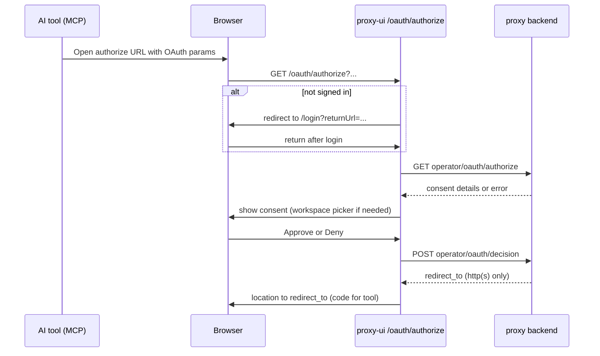

# Operator MCP OAuth consent

How an AI tool (MCP client) obtains operator access to 36Blocks APIs through browser OAuth. This is **not** the widget `auth2` flow on customer sites ([widget-verification](./widget-verification.md)).

## Entry

- Route: `apps/36-blocks/src/app/app.routes.ts` → `path: 'oauth/authorize'`, `canActivate: [CanActivateRouteGuard]`.
- Params are parsed in `oauth-consent.ts` (`parseAuthorizeRequest`, `classifyAuthorizeResponse`). Malformed requests stop at **invalid**; the redirect URI from the tool is never used for errors.

## Consent UI states

`OAuthAuthorizeComponent` uses a discriminated `view` signal:

| Kind | Meaning |
|---|---|
| `loading` | Initial authorize call |
| `invalid` | Client-side validation failed |
| `error` | Network or server error message |
| `denied` | User denied (terminal message) |
| `no-workspace` | Signed in but no client; create or switch workspace |
| `ready` | Show scopes and Approve / Deny |
| `done` | Decision sent; browser navigating away |

While `busy` is set, both buttons are disabled. `decisionError` shows recoverable failures without navigating away.

## Workspace and client switch

Consent is tied to the **current** workspace (token-scoped client). If the tool's request does not match the active client, the operator can switch via the workspace dropdown (`RootService` / `switchClient` pattern) or create a workspace through `CreateWorkspaceDialogComponent`. Switching uses the same full reload as elsewhere so stores reset ([panel-ops](../modules/panel-ops.md#clients-and-projects)).

## PKCE

`code_challenge` and `code_challenge_method` are forwarded when present on the authorize query and in the decision body. They are optional: tools that do not send PKCE still work when the server allows it (verified in `tools/tests/oauth-consent.test.cjs`).

## After approval

1. `POST operator/oauth/decision` with `OAuthDecisionAction` approve or deny.
2. Response `redirect_to` must pass `safeRedirectTarget` (http or https).
3. Browser navigates to that URL; the tool completes the code exchange outside this repo.

Connected tools appear under **Team & access → Connected AI tools**; revoke flow in [panel-team-access](../modules/panel-team-access.md).

## Related: Set up with AI

Operators who land with zero blocks may hit `/app/setup` via `zeroBlocksGuard` before using the dashboard; MCP connection instructions in the wizard use the same server URL as this flow. See [panel-ai-setup](../modules/panel-ai-setup.md).