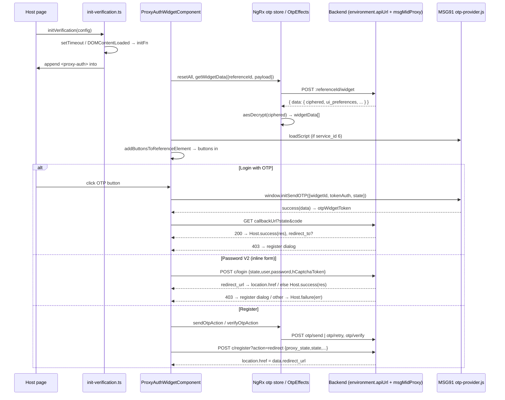

# Flow: widget verification (login widget on a host page)

A host page loads the built proxy-auth.js bundle and calls `window.initVerification(config)` with `type: 'authorization'`. The widget mounts `<proxy-auth>` in the host's `referenceId` div, fetches and decrypts the feature's auth services, draws the sign-in buttons, and finishes with a redirect or the host's `success` / `failure` callback.

Read first: [widget-embed](../modules/widget-embed.md) (bootstrap, globals, shadow DOM), [widget-auth](../modules/widget-auth.md) (screen state machine, store, encryption keys), [shared-libs](../modules/shared-libs.md) (`HttpWrapperService` no-auth). The config contract and endpoint list live in [api.md](../api.md). This doc only follows the calls.



## Steps

### A. Script load and mount
1. **Bundle runs once** — `apps/36-blocks-widget/src/main.ts`
   The load-once guard, `createApplication` and the `proxy-auth` custom element definition are described in [widget-embed](../modules/widget-embed.md#bootstrap-production). The API base URL is `environment.apiUrl + environment.msgMidProxy` (`ProxyBaseUrls.BaseURL`).
2. **Host calls `initVerification(config)`** — `apps/36-blocks-widget/src/app/init-verification.ts`
   Defaults `type` to `PublicScriptType.Authorization`, runs `validateWidgetConfig` (console only), then defers `initFn` with `setTimeout(…, 1)` or `DOMContentLoaded`.
3. **`initFn` builds the element** — `init-verification.ts`
   Throws `Reference Id is missing!` if `referenceId`, `authToken` and `showCompanyDetails` are all absent; throws `success callback function missing !` if `config.success` is not a function. Removes the first existing `proxy-auth`, creates a new one, copies inputs, sets `successReturn = config.success`, `failureReturn = config.failure`, and `otherData` (see shapes).
4. **Container lookup** — `init-verification.ts`
   For `authorization` the container id is `config.referenceId`. Found → `container.append(el)` and `window.libLoaded = true`. Not found → `MutationObserver` + 150 ms interval, give up after 30 s with `console.error`.

### B. Widget boot and config fetch
5. **`ngOnInit`** — `apps/36-blocks-widget/src/app/otp/widget/widget.component.ts:ProxyAuthWidgetComponent.ngOnInit`
   `captureHostPageUrl`, `store.dispatch(resetAll())`, theme input. If `authType === WidgetAuthType.Auth2` → step 20, else step 6.
6. **Classic boot** — `apps/36-blocks-widget/src/app/otp/widget/widget.component.ts:initClassicAuthorizationWidget`
   Subscribes `selectWidgetTheme` (copies `ui_preferences` into `version`, `input_fields`, `isCreateAccountTextAppended` …). Calls `toggleSendOtp(true)`. If `isRegisterFormOnly` → `registrationViaLogin = false; setShowRegistration(true)` (opens register at once). Dispatches `getWidgetData({ referenceId, payload: buildWidgetDataPayload() })`. If `referenceId` is falsy it only logs.
7. **Skeleton + wait for buttons** — `apps/36-blocks-widget/src/app/otp/widget/widget.component.ts:toggleSendOtp`
   For Authorization: closes login, then on the next tick draws `ProxyAuthDomBuilderService.appendSkeletonLoader` in `#buttonContainer` and calls `addButtonsToReferenceElement`. A 10 s timeout force-removes the skeleton.
8. **Fetch config** — `apps/36-blocks-widget/src/app/otp/store/effects/otp.effects.ts:OtpEffects.getWidgetData$` → `apps/36-blocks-widget/src/app/otp/service/otp.service.ts:OtpService.getWidgetData`
   `POST otpVerificationUrls.getWidgetData` (`:referenceId/widget`) with body = payload. The effect `aesDecrypt`s `res.data.ciphered` with `environment.apiEncodeKey` / `apiIvKey`, `JSON.parse`s it, and dispatches `getWidgetDataComplete({ response: parsed, theme: res.data })`. Any throw (HTTP error, bad key, bad JSON) → `getWidgetDataError`.
9. **Reducer** — `apps/36-blocks-widget/src/app/otp/store/reducers/otp.reducer.ts:otpReducer`
   `widgetData = response`, `theme = res.data`. On error: `errors`, `apiErrorResponse`, `closeWidgetApiFailed = true`; `widgetData` stays `null`.
10. **Pick services** — `initClassicAuthorizationWidget` (`selectWidgetData` subscription)
    `service_id === FeatureServiceIds.Msg91OtpService` (6) → `otpWidgetData`, `OtpWidgetService.setWidgetConfig(widget_id, token_auth, state)` and `loadScript()` (injects `https://verify.msg91.com/otp-provider.js?v=<timestamp>` into `<head>`). `FeatureServiceIds.PasswordAuthentication` (9) → `loginWidgetData` unless `theme.registerState` already set it.
11. **Draw buttons** — `apps/36-blocks-widget/src/app/otp/widget/widget.component.ts:addButtonsToReferenceElement` → `appendButton` / `appendPasswordAuthenticationButtonV2`
    Waits for the first non-null `selectWidgetData`. Per item:
    - service 6: appended when `scriptLoading` turns false, or after 4 s.
    - service 9 on a sign-up route (`isSignupRoute`): skipped.
    - service 9 with `version === 'v1'`, or any other service: a button (`appendButton`).
    - service 9 with v2: inline form (`appendPasswordAuthenticationButtonV2` → `buildLoginFields`, hCaptcha via `ensureHCaptchaScriptLoaded`).
    Then `checkAndAppendCreateAccountText` adds "Create an account" (opens step 17) and the footer. Fallback timers at 3 s and 8 s unhide everything.
    Button click: `urlLink` → `window.open(urlLink, target)` (social login, leaves the widget); service 6 → step 12; service 9 (v1) → `setShowLogin(true)` → step 16.

### C. Login with OTP (MSG91 hosted)
12. **Open MSG91** — `apps/36-blocks-widget/src/app/otp/service/otp-widget.service.ts:OtpWidgetService.openWidget`
    Calls `window.initSendOTP({ widgetId, tokenAuth, state, success, failure })` (loads the script first if `scriptAdded` is false). MSG91 owns the phone/email entry, send, retry and verify UI.
13. **Token back** — `OtpWidgetService` `success(data)` → `otpWidgetToken.next(data.message)`. `failure(error)` → `otpWidgetError.next(error)`, which nothing subscribes to.
14. **Callback URL** — `apps/36-blocks-widget/src/app/otp/widget/widget.component.ts:hitCallbackUrl` → `OtpService.callBackUrl`
    `GET otpWidgetData.callbackUrl` (absolute URL from widget data) with query `{ state, code: token }`.
    - success → `this.successReturn(res)`; then `location.href = res.data.redirect_to` after 100 ms if present, else `toggleSendOtp()` (closes dialogs, buttons stay).
    - `error.status === 403` and registration not blocked → `setShowRegistration(true)`, `show = true`, `registrationViaLogin = false` → step 17.
    - any other error → nothing (no host callback, no UI message).

### D. Password login
15. **V2 inline form** — `apps/36-blocks-widget/src/app/otp/widget/widget.component.ts:handlePasswordAuthenticationLogin` → `OtpService.login`
    Validates username/password/hCaptcha inline (`setInlineError`). `POST c/login` with `{ state, user, password: encryptPassword(pw), hCaptchaToken }`.
    - 200 with `hasError` → inline error, hCaptcha reset, no host callback.
    - 200 with `data.redirect_url` → `window.location.href = redirect_url`.
    - 200 otherwise → `returnSuccessObj(res)` → host `success(res)`.
    - 403 and registration not blocked → `setShowRegistration(true, username)` → step 17 (prefilled).
    - other errors → inline error + `returnFailureObj(error)` → host `failure(HttpErrorResponse)`.
    "Forgot password" opens the widget's own two-step dialog (`openForgotPasswordDialog` → `sendForgotPasswordOtp` / `submitForgotPasswordChange`; `c/resetPassword`, `c/verifyResetPassword`).
16. **V1 dialog** — `apps/36-blocks-widget/src/app/otp/component/login/login.component.ts:LoginComponent.login` → `apps/36-blocks-widget/src/app/otp/component/login/login.store.ts:LoginComponentStore.loginData`
    Same `c/login` payload. `data.redirect_url` → `window.location.href`. 200 without it → stored in `logInData` only (host gets nothing). 403 → `showRegistration$` → `openPopUp` → `setShowRegistrationFromLogin(username)` → step 17. Other errors → `apiError` in the dialog.

### E. Register
17. **Open dialog** — `apps/36-blocks-widget/src/app/otp/widget/widget.component.ts:setShowRegistration`
    Sets `showRegistration`, `prefillDetails`, and attaches `#dialogPortal` with `WidgetPortalService.attach`. `proxy-register` gets `serviceData = otpWidgetData`, `loginServiceData = loginWidgetData`, `registrationViaLogin`, and `otherData.firstName/lastName/email/signupServiceId`.
18. **OTP inside the form** — `apps/36-blocks-widget/src/app/otp/component/register/register.component.ts:RegisterComponent.sendOtpForChannel` / `verifyOtpForChannel`
    Dispatches `sendOtpAction({ request: { referenceId, identifier, useRetry } })` → `OtpEffects.getOtp$` → `otp/send` or `otp/retry`; then `verifyOtpAction({ request: { referenceId, identifier, otp } })` → `OtpEffects.verifyOtpV2$` → `otp/verify`. Headers come from `OtpService.setOtpRequestHeaders` (`reference_id`, `origin`). The token `data.otp_verification_token` is stored per `pendingOtpChannel`. Details in [widget-auth](../modules/widget-auth.md#4-otp-send--verify--retry).
19. **Submit** — `RegisterComponent.submit` → `OtpService.register`
    Requires verified mobile OTP (if the field rules need it) and verified email OTP (unless `isRegisterFormOnly`). Decrypts the service `state` for `url_unique_id`, encrypts the payload into `proxy_state`, `POST c/register?action=redirect`. Success → `window.location.href = response.data.redirect_url`. Error → `apiError` in the form. The host never gets `success` from registration.

### F. OAuth 2.0 (`authType: 'auth2'`)
20. **Authorize check** — `apps/36-blocks-widget/src/app/otp/widget/widget.component.ts:initOauthAuthorize` → `OtpService.getOauthAuthorize`
    Reads the host URL query (`readHostQueryParams`).
    - No `proxy_auth_token` → `GET oauth/authorize` with all params. `isOauthAuthorizeSuccess` (no `hasError` and `client_id` or `client_name` in data) → `oauthAuthorizeData`, then step 6. `buildWidgetDataPayload` adds `addInfo.redirect_path = location.pathname` and `state = JSON.stringify(oauthAuthorizeParams)` to the widget-data body. Failure → `openOauthErrorPage(message)` (static dialog, no widget data call).
    - `proxy_auth_token` and `state` present (back from login) → `resolveAuthorizeParamsAfterLogin` rebuilds params from the JSON `state`, re-validates `oauth/authorize`, then `openOauthConsentDialog`.
21. **Consent** — `apps/36-blocks-widget/src/app/otp/widget/widget.component.ts:submitOauthConsent` → `OtpService.postOauthAuthorizeDecision`
    `POST oauth/authorize/decision` with header `proxy_auth_token` and body `{ action: 'approve'|'deny', client_id, redirect_uri, state, response_type, scope?, code_challenge?, code_challenge_method? }`. `data.redirect_to` → `window.location.href`; missing → inline error; HTTP error → `oauthConsentError` from `error` / `error_description`. No host callback in either case.

## Data at key hops

`otherData` set by `initFn` (sent as the `getWidgetData` body; `RESERVED_KEYS` removed):
```json
{
  "firstName": "from ?first_name", "lastName": "from ?last_name", "email": "from ?email", "signupServiceId": "from ?signup_service_id",
  "type": "authorization",
  "addInfo": { "redirect_path": "config.redirect_path (moved)" },
  "...any other host config key": "passed through, e.g. theme, version, isPreview"
}
```

`getWidgetData` response and what the store keeps:
```json
// HTTP body
{ "data": { "ciphered": "<base64 AES>", "ui_preferences": { "version": "v2", "theme": "dark", "input_fields": "top", "icons": false, "block_registration": false, "border_radius": "medium", "remove_branding": false }, "registration_fields": { "mobile": "optional_with_otp" }, "registerState": { "...": "optional" } } }
// state.otp.theme = data ; state.otp.widgetData = JSON.parse(aesDecrypt(data.ciphered)):
[
  { "service_id": 6, "text": "Login with OTP", "icon": "...", "state": "<opaque>", "widget_id": "...", "token_auth": "...", "callbackUrl": "https://..." },
  { "service_id": 9, "text": "Login", "state": "<opaque>" },
  { "service_id": 7, "text": "Continue with Google", "urlLink": "https://..." }
]
```
The item shape is not typed in code; keys are the ones the component reads. Service ids are `FeatureServiceIds` in `libs/models/features-model/src/index.ts`.

OTP callback call (step 14): `GET <callbackUrl>?state=<otpWidgetData.state>&code=<MSG91 data.message>`.

Login body (steps 15 and 16):
```json
{ "state": "<service 9 state>", "user": "email or mobile without leading +", "password": "<AES(uiEncodeKey) of JSON string>", "hCaptchaToken": "..." }
```

Register body (step 19):
```json
{ "proxy_state": "<AES(uiEncodeKey) of {reference_id, service_id, url_unique_id, request_data, signup_service_id?}>", "state": "<service state>", "email_otp_verification_token": "?", "mobile_otp_verification_token": "?" }
```

## Errors

What the host receives, by case:

| Case | Caught in | Host gets |
|---|---|---|
| No `referenceId`/`authToken`/`showCompanyDetails`, or no `success` function | `initFn` `throw` inside a timer | Uncaught error in the console; a host `try/catch` never sees it |
| Container div never appears | `init-verification.ts` `tryMount` | `console.error` after 30 s; nothing else |
| `getWidgetData` HTTP error, wrong `AUTH_API_*` key, bad JSON | `OtpEffects.getWidgetData$` `catchError` | Nothing. No buttons; skeleton removed by the 10 s timeout; `[36Blocks] getWidgetData failed` in the console |
| MSG91 `failure` | `OtpWidgetService` → `otpWidgetError` | Nothing (no subscriber) |
| Callback URL 200 | `hitCallbackUrl` | `success(res)`, then redirect to `res.data.redirect_to` if set |
| Callback URL 403 | `hitCallbackUrl` | Nothing; register dialog opens (unless `block_registration`) |
| Callback URL other error | `hitCallbackUrl` | Nothing at all |
| V2 login: 200 + `hasError` | `handlePasswordAuthenticationLogin` | Nothing; inline error |
| V2 login: other HTTP error | same | `failure(HttpErrorResponse)` + inline error |
| V1 login success without `redirect_url` | `LoginComponentStore.loginData` | Nothing |
| Register error | `RegisterComponent.submit` | Nothing; error in the form |
| OAuth authorize invalid | `initOauthAuthorize` | Nothing; static error dialog |
| User closes login/register (X button or Esc) | `closeOverlayDialog` | Nothing (see warning) |

> [!WARNING]
> Closing a dialog does not call the host's `failure`. The dialog's X button in `widget.component.html` calls `closeOverlayDialog()`, and Esc detaches the portal, which also ends in `closeOverlayDialog`. `LoginComponent.close(true)` and `RegisterComponent.close(true)` are the only code that emits `{ code: 0, closeByUser: true, message: 'User cancelled the …' }`, and no template or class calls them. That payload is unreachable at this commit.

> [!WARNING]
> `hitCallbackUrl` calls `this.successReturn(res)` directly, not `returnSuccessObj`. It also swallows every non-403 error, so a broken `callbackUrl` leaves the user on the button list with no message and the host with no callback.

> [!WARNING]
> The 403 → register path differs per login type. V2 and the OTP callback check `!this.isCreateAccountTextAppended` (`ui_preferences.block_registration`). V1 (`LoginComponentStore`) opens the register dialog on any 403, and `proxy-login` only hides its own "create account" link via the `isCreateAccountTextAppended` input.

> [!WARNING]
> `otpWidgetToken` is a `BehaviorSubject`. The widget component subscribes with `filter(Boolean)`, so after the first MSG91 success any re-created `ProxyAuthWidgetComponent` sharing the same `OtpWidgetService` instance would replay the old token and hit the callback URL again. `OtpWidgetService` is provided once in `main.ts`, so this applies when `initVerification` is called twice on one page after a login.

> [!TODO] Needs a human: should `otpWidgetError` and the non-403 `hitCallbackUrl` errors reach the host's `failure` callback?

## Side effects

| Step | Effect |
|---|---|
| 3–4 | Removes the first `<proxy-auth>` and `#skeleton-loader` nodes; appends `<proxy-auth>` to `#<referenceId>`; sets `window.libLoaded` |
| 5 | `resetAll` clears the whole `otp` store slice |
| 8 | `POST :referenceId/widget` (body `otherData`, no `reference_id` header — the id is in the path) |
| 10 | `<script src="https://verify.msg91.com/otp-provider.js?v=…">` appended to the host `<head>` |
| 11 | DOM built with `Renderer2` in the shadow root; v2 adds `<script src="https://js.hcaptcha.com/1/api.js?render=explicit">` to `<head>`; social buttons `window.open(urlLink, target)` |
| 14 | `GET callbackUrl`; optional `location.href = redirect_to` |
| 15–16 | `POST c/login`; optional `window.location.href = redirect_url` |
| 17 | Dialog moved into a shadow host on `document.body` (`WidgetPortalService.attach`) |
| 18 | `POST otp/send` / `otp/retry` / `otp/verify`; writes `reference_id` and `origin` into the shared `OtpService.options.headers` (see [widget-auth](../modules/widget-auth.md#gotchas)) |
| 19 | `POST c/register?action=redirect`; `window.location.href = redirect_url` |
| 20–21 | `GET oauth/authorize`, `POST oauth/authorize/decision`; `window.location.href = redirect_to` |

The widget writes no cookies and no `localStorage`. Sessions are created by the backend responses and the redirects (`redirect_url`, `redirect_to`), which carry the user off the host page.
